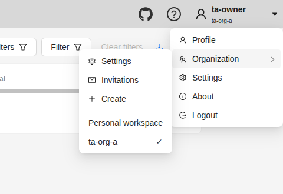

# Создание организаций

В форке новую организацию (organization) создаёт только администратор (administrator) — участник группы `admin`. Эта страница нужна, когда вы решаете, кто заводит организации на сервере, или когда пользователь (user) спрашивает, почему у него не получилось её создать.

## Что изменено относительно CVAT

| CVAT v2.82.0 | Форк |
| --- | --- |
| Организацию может создать любая учётная запись (account) с глобальной ролью `user` или `admin`. | Организацию может создать только учётная запись с глобальной ролью `admin`. |
| Интерфейс показывает пункт «Create» всем. | Без изменений: пункт «Create» видят все, но сервер отказывает всем, кроме администраторов. |

Остальные права на организации, участников и приглашения не изменены.

## Кому доступно

| Кто | Может создать организацию |
| --- | --- |
| Администратор (группа `admin`) | Да |
| Пользователь с глобальной ролью `user` или `worker` | Нет, сервер отвечает отказом |

Правило действует, пока на сервере не изменена настройка, описанная в разделе «Настройки».

## Где находится

1. Откройте меню учётной записи в правом углу шапки (header).
2. Щёлкните пункт «Organization»: меню и этот пункт открываются по щелчку, а не по наведению.
3. Выберите «Create». Откроется страница `/organizations/create` с заголовком «Create a new organization».

*На снимке тестовые данные: имена учётной записи и организации вымышлены. Пункт «Settings» есть, только когда организация выбрана; если организаций больше пяти, вместо их списка стоит «Switch organization».*

## Как это работает

Администратор создаёт организацию так:

1. На странице «Create a new organization» заполните «Short name» — обязательное поле: только латинские буквы и цифры, без дефисов и пробелов, не длиннее 16 символов, например `visionteam`.
2. При желании заполните «Full name» (не длиннее 64 символов, например «Vision Team»), «Description», «Email», «Phone number» и «Location».
3. Нажмите «Submit». После создания новая организация становится выбранной и открывается её страница `/organization`.

«Cancel» возвращает на предыдущую страницу.

Пользователь, который не администратор, видит тот же пункт «Create» и ту же форму: интерфейс не скрывает их. Сервер проверяет право в момент запроса `POST /api/organizations` и отвечает статусом HTTP 403 с текстом «You do not have permission to perform this action.». Организация не создаётся, форма остаётся открытой, и запрос можно отправить снова.

Правило касается только создания. Организации, которые уже есть, их участники (members) и роли участников (`owner`, `maintainer`, `supervisor`, `worker`) не меняются. Владелец существующей организации по-прежнему управляет ею и приглашает участников, как в CVAT.

## Состояния и ошибки

| Что вы видите | Причина | Что делать |
| --- | --- | --- |
| Уведомление «Could not create organization `<short name>`» с текстом ответа сервера | Ваша учётная запись не в группе `admin`, сервер ответил HTTP 403. | Попросите администратора создать организацию и пригласить вас в неё. |
| «Short name is a required field» | Поле «Short name» пустое. | Заполните его. |
| «Short name must not exceed 16 characters» | Короткое имя длиннее 16 символов. | Сократите его. |
| «Only Latin characters and numbers are allowed» | В коротком имени есть дефис, пробел или другой символ, кроме латинских букв и цифр. Форма не отправляется. | Оставьте только латинские буквы и цифры. |
| «Full name must not exceed 64 characters» | Полное имя длиннее 64 символов. | Сократите его. |
| «The input is not a valid E-mail» | В поле «Email» не адрес электронной почты. | Исправьте адрес или очистите поле. |
| «Input phone number is not correct» | В поле «Phone number» есть символы, кроме цифр, пробелов, `-` и `+` в начале. | Исправьте номер или очистите поле. |
| Пункт «Organization» в меню неактивен | Интерфейс ещё загружает организации. | Подождите окончания загрузки. |

## Настройки

Кому разрешено создавать организации, задаёт настройка сервера; её значения и значение по умолчанию описаны в [server-settings.md](server-settings.md).

## См. также

- [Настройки сервера](server-settings.md)
- [Права участников на issue и комментарии](issue-permissions.md)
- [Access: organization creation](../../access.md#organization-creation) — то же правило для тех, кто устанавливает сервер (на английском)
