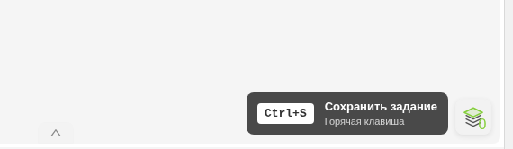

# Подсказки о горячих клавишах

Подсказка о горячей клавише ([shortcut hint](../../../GLOSSARY.md#shortcut-hint)) появляется в углу холста (canvas), когда вы несколько раз сделали мышью то, для чего есть горячая клавиша (hotkey): она называет действие и клавишу. Эта страница объясняет, когда подсказка появляется, для каких действий она есть и почему её может не быть.

## Что изменено относительно CVAT

| CVAT v2.82.0 | Форк |
| --- | --- |
| Клавишу действия показывает всплывающая подсказка (tooltip) при наведении на кнопку и окно со списком сочетаний (клавиша `F1`). | То же, и ещё подсказка после действия мышью: она появляется сама, без наведения, и исчезает сама. |

## Кому доступно

Каждому пользователю (user), который открыл задание (job) 2D. В заданиях 3D подсказок нет. Своей настройки у пользователя нет: скрыть подсказку или выключить подсказки для себя нельзя.

## Где находится

Страница задания, правый нижний угол холста, слева от кнопки стопки слоёв («Open layer stack»).

## Как это работает

В подсказке три части:

| Часть | Что показывает |
| --- | --- |
| Клавиша | Сочетание, которое назначено действию сейчас в ваших настройках горячих клавиш CVAT, например `Ctrl+S`. Если у действия несколько сочетаний, показано первое. |
| Название | Что делает действие, по-русски, например «Сохранить задание». |
| «Горячая клавиша» | Подпись под названием, одна и та же во всех подсказках. |

Подсказка для «Сделать копию» показывает две клавиши через стрелку, `Ctrl+C` → `Ctrl+V`: копия делается двумя сочетаниями подряд.

Подсказка не принимает щелчков: то, что под ней, остаётся доступным. Через 5 секунд она исчезает сама. Одновременно показана только одна подсказка: новая заменяет прежнюю.

### Когда подсказка появляется

- Действие становится поводом для подсказки, когда вы сделали его мышью в третий раз за час.
- Для одного действия подсказка появляется не чаще раза в час.
- Любые подсказки появляются не чаще одной в 2 минуты и не больше 10 в час. Действие, для которого подсказка из-за этого не показана, получит её при следующем щелчке после паузы.
- Когда вы делаете действие в основном горячей клавишей, подсказки для него нет 3 дня. «В основном» значит: за последний час нажатий клавиши этого действия больше половины от всех его выполнений, то есть нажатий клавиши и действий мышью вместе. Проверяется это при каждом нажатии клавиши, с учётом самого нажатия. Ровно половины мало: если за час вы дважды сделали действие мышью, а потом дважды нажали клавишу, подсказка не отключается (на втором нажатии клавишей сделана ровно половина), а третье нажатие её отключает. Порядок важен: нажатие без щелчков перед ним за этот час отключает подсказку сразу.
- Нажатие во время этих 3 дней проверяется так же: если клавишей сделано больше половины за час, 3 дня отсчитываются заново, а если нет, подсказка вернётся в прежний срок. Если после этих 3 дней вы снова делаете действие мышью, правила выше действуют заново.
- Нажатия клавиши считаются там же, где и щелчки: в открытом 2D-задании. Нажатие в 3D-задании подсказку не отключает. Не считается и нажатие, после которого действие не выполнилось: например, `Ctrl+C` над выделенным текстом копирует текст, а не объект.
- Зажатая клавиша считается одним нажатием, сколько бы раз она ни сработала, пока вы её держите (например, при перелистывании кадров клавишей `F`).

Щелчок, сделанный с клавиатуры (клавиша `Enter` или пробел на кнопке в фокусе), действием мышью не считается.

Пример: вы трижды за несколько минут нажали мышью кнопку сохранения. После третьего щелчка появляется подсказка `Ctrl+S` «Сохранить задание». Четвёртый щелчок подсказку не вызывает. Если вы один раз нажали `Ctrl+S`, а сохраняете по-прежнему мышью, подсказка через час появится снова. Если за час вы сохраняли сочетанием `Ctrl+S` чаще, чем мышью (или нажали `Ctrl+S`, ни разу за этот час не сохранив мышью), подсказки для сохранения не будет три дня.

### Для каких действий есть подсказка

Клавиша по умолчанию — та, что назначена в CVAT, пока вы её не изменили. Подсказка всегда показывает вашу текущую клавишу.

| Где | Название в подсказке | Клавиша по умолчанию |
| --- | --- | --- |
| Верхняя панель | «Сохранить задание» | `Ctrl+S` |
| Верхняя панель | «Отменить действие» | `Ctrl+Z` |
| Верхняя панель | «Повторить действие» | `Ctrl+Shift+Z` |
| Верхняя панель, кнопки кадров | «Назад на шаг» | `C` |
| Верхняя панель, кнопки кадров | «Предыдущий кадр» | `D` |
| Верхняя панель, кнопки кадров | «Воспроизведение и пауза» | `Space` |
| Верхняя панель, кнопки кадров | «Следующий кадр» | `F` |
| Верхняя панель, кнопки кадров | «Вперёд на шаг» | `V` |
| Верхняя панель | «Удалить кадр» | `Alt+Del` |
| Панель инструментов слева | «Вернуться к курсору» | `Esc` |
| Панель инструментов слева | «Повернуть по часовой стрелке» | `Ctrl+R` |
| Панель инструментов слева | «Повернуть против часовой стрелки» | `Ctrl+Shift+R` |
| Панель инструментов слева, кнопки «Shape» и «Track» в окне рисования | «Повторить рисование» | `N` |
| Панель инструментов слева | «Режим объединения» | `M` |
| Панель инструментов слева | «Режим группировки» | `G` |
| Панель инструментов слева | «Режим разделения трека» | `Alt+M` |
| Панель инструментов слева | «Режим соединения» | `J` |
| Панель инструментов слева, меню объекта | «Режим разрезания» | `Alt+J` |
| Панель инструментов слева, рабочее пространство проверки | «Открыть замечание» | `N` |
| Боковая панель, рабочее пространство тегов | «Добавить тег» | `N` |
| Кнопки объекта, быстрые действия выделения | «Заблокировать или разблокировать объект» | `L` |
| Кнопки объекта, быстрые действия выделения | «Переключить перекрытие» | `Q` |
| Кнопки объекта, быстрые действия выделения | «Закрепить или открепить объект» | `P` |
| Кнопки объекта, быстрые действия выделения | «Скрыть или показать объект» | `H` |
| Кнопки объекта | «Переключить «вне кадра»» | `O` |
| Кнопки объекта | «Переключить ключевой кадр» | `K` |
| Кнопки объекта | «Предыдущий ключевой кадр» | `E` |
| Кнопки объекта | «Следующий ключевой кадр» | `R` |
| Быстрые действия выделения | «Удалить объект» | `Del` |
| Заголовок списка объектов | «Заблокировать или разблокировать все объекты» | `T L` (клавиши по очереди) |
| Заголовок списка объектов | «Скрыть или показать все объекты» | `T H` (клавиши по очереди) |
| Меню объекта | «Сделать копию» | `Ctrl+C` → `Ctrl+V` |
| Меню объекта | «Распространить объект» | `Ctrl+B` |
| Меню объекта | «Переместить на задний план» | `-` |
| Меню объекта | «Переместить на передний план» | `+` |
| Меню объекта | «На один слой назад» | не назначена |
| Меню объекта | «На один слой вперёд» | не назначена |
| Меню объекта | «Изменить цвет» | `Enter` |
| Меню объекта | «Упростить полигон» | не назначена |
| Рабочее пространство атрибутов | «Предыдущий объект» | `Shift+Tab` |
| Рабочее пространство атрибутов | «Следующий объект» | `Tab` |
| Рабочее пространство атрибутов | «Предыдущий атрибут» | `Arrow Up` |
| Рабочее пространство атрибутов | «Следующий атрибут» | `Arrow Down` |

### Когда подсказки нет

- Вы в задании 3D или не в задании.
- У действия нет клавиши: она не назначена по умолчанию (в таблице выше — «не назначена») или вы её убрали. Назначьте клавишу в настройках CVAT, и подсказка для действия появится.
- Сочетание не работает в открытом рабочем пространстве (workspace): подсказка называет только клавишу, которая сработает там, где вы сейчас.
- Действие не входит в таблицу выше. Подсказок нет для смены метки (label) объекта и для пунктов «Remove» и «Run annotation action» в меню объекта.
- Ещё не было трёх действий мышью за час, либо сработало одно из ограничений частоты.
- В последние 3 дня вы делали это действие в основном горячей клавишей: за час нажатий клавиши было больше половины.

### Что запоминается

Сколько раз за последний час вы сделали действие мышью и нажали его горячую клавишу, когда были показаны подсказки и до какого времени их нет, запоминает браузер, а не сервер. Поэтому счёт общий для вкладок одного браузера и не сбрасывается при перезагрузке страницы, а в другом браузере или после очистки данных сайта начинается заново.

## Состояния и ошибки

| Что вы видите | Причина | Что делать |
| --- | --- | --- |
| Подсказка появилась и исчезла через 5 секунд. | Обычная работа. | Ничего. |
| Подсказки нет, хотя вы много раз нажали кнопку мышью. | Одна из причин раздела «Когда подсказки нет». | Проверьте, что у действия есть клавиша и что задание 2D. |
| Подсказки перестали появляться для всех действий до перезагрузки страницы. | В подсказках произошёл сбой. Они выключают себя до перезагрузки, чтобы не мешать разметке. | Перезагрузите страницу. |

## Настройки

Настроек (setting) сервера у подсказок нет. Клавиши действий меняются в настройках CVAT, на вкладке «Shortcuts»: подсказка показывает клавишу, которая назначена сейчас.

## См. также

- [Как считаются показатели Team Analytics](team-analytics-figures.md) — горячие клавиши и мышь в цифрах команды.
- [Глоссарий](../../../GLOSSARY.md#shortcut-hint)
