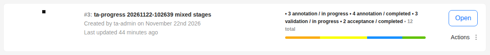

# Прогресс задачи по stage и state

В списке задач (task) у каждой задачи есть полоса прогресса задачи ([task progress bar](../../../GLOSSARY.md#task-progress-bar)): она делит задания (job) задачи по stage и state. Эта страница нужна, чтобы читать цвета полосы и подписи над ней.

## Что изменено относительно CVAT

| CVAT v2.82.0 | Форк |
| --- | --- |
| Подпись над полосой: «• N done», «• N on review», «• N annotating», «• N total». | Подпись: по одному пункту «• N `<stage>` / `<state>`» на каждую пару stage и state, где есть задания, затем «• N not available», если такие задания есть, и «• N total». |
| Полоса из двух цветов: завершённые задания и задания на проверке. | Полоса из сегментов, один сегмент на пару stage и state, у каждой пары свой цвет. |
| Числа берутся из ответа сервера со списком задач. | Числа считаются по самим заданиям, которые интерфейс запрашивает отдельно. Если этот запрос не удался, показывается полоса CVAT. |

## Кому доступно

Полосу видит каждый пользователь (user), который открыл список задач. Сегменты строятся только из заданий, которые этот пользователь может получить; остальные задания задачи попадают в сегмент «not available». Настроек на сервере для полосы нет.

## Где находится

Страница «Tasks» (`/tasks`), правая часть карточки каждой задачи в списке. Тот же список задач показывает и страница проекта (project): там полоса работает так же.

*На снимке тестовые данные: имена задачи и учётной записи вымышлены.*

## Как это работает

Один сегмент — это одна пара stage и state задания. Stage принимает значения `annotation`, `validation`, `acceptance`; state — `new`, `in progress`, `completed`, `rejected`. Цвет каждой из двенадцати пар:

| Stage | State | Цвет |
| --- | --- | --- |
| `annotation` | `new` | `#c1c1c1` |
| `annotation` | `in progress` | `#faad14` |
| `annotation` | `completed` | `#fafe01` |
| `annotation` | `rejected` | `#ff4136` |
| `validation` | `new` | `#b4dafd` |
| `validation` | `in progress` | `#1890ff` |
| `validation` | `completed` | `#00478a` |
| `validation` | `rejected` | `#ff4136` |
| `acceptance` | `new` | `#b3ff66` |
| `acceptance` | `in progress` | `#b3ff66` |
| `acceptance` | `completed` | `#61c200` |
| `acceptance` | `rejected` | `#ff4136` |

Некоторые пары имеют одинаковый цвет: `rejected` во всех трёх stage, `acceptance` / `new` и `acceptance` / `in progress`. Различить их можно по подписи и подсказке.

Сегмент «not available» ([not available segment](../../../GLOSSARY.md#not-available-segment)) стоит последним и окрашен в `#c1c1c1`, как `annotation` / `new`. Его размер — общее число заданий задачи минус число заданий, которые интерфейс получил; меньше нуля он не бывает.

| Элемент | Что показывает |
| --- | --- |
| Подпись над полосой | Для каждого непустого сегмента по порядку таблицы выше: «• N `<stage>` / `<state>`», например «• 3 annotation / in progress», затем «• N not available», если таких заданий больше нуля, последним — «• N total» с общим числом заданий из ответа сервера со списком задач. |
| Сегмент | Пара stage и state, в которой есть хотя бы одно задание. Пустые пары не показываются. |
| Подсказка (tooltip) сегмента | При наведении: число и пара, например «3 validation / completed» или «2 not available». |

Ширина: сегменты делят ширину полосы пропорционально числу заданий в них. Самый маленький сегмент не уже 2 пикселей.

Когда числа обновляются:

1. Интерфейс получает страницу списка задач: при открытии списка, при смене страницы, поиске, фильтре или сортировке, после переноса задач в другую организацию.
2. Сразу после этого он запрашивает (request) все задания задач этой страницы, фильтром по id задач, страницами по 500 заданий, и считает их по stage и state. Если на странице нет задач, запроса нет.
3. Пока этот запрос идёт, у задач видна полоса CVAT; когда он закончится, её заменяет полоса по stage и state.

Периодического опроса нет: если state задания меняется, пока список открыт, полоса изменится только после следующей загрузки списка. Если пришёл ответ на более ранний запрос списка, чем последний, он не применяется.

## Состояния и ошибки

| Что вы видите | Причина | Что делать |
| --- | --- | --- |
| Полоса CVAT из двух цветов с подписью «done», «on review», «annotating», «total» | Задания задач ещё загружаются, или их не удалось загрузить. Сообщения об ошибке нет. | Подождите или перезагрузите список задач. |
| Сегмент «not available» | Интерфейс получил меньше заданий, чем общее число заданий задачи: обычно у вас нет доступа к части заданий. | Ничего: это не ошибка. |
| Прогресс создания задачи вместо полосы | Задача ещё создаётся. | Дождитесь окончания создания. |
| Подпись занимает несколько строк, а полосы под ней не видно | У задачи задания во многих парах stage и state: длинная подпись не помещается в карточку задачи и вытесняет полосу. Так выглядит задача с заданиями во всех двенадцати парах. | Читайте числа в подписи: в ней те же пары и количества, что в сегментах. |

## Настройки

Настроек нет.

## См. также

- [Сценарии](../scenarios.md)
- [Оглавление](../README.md)
