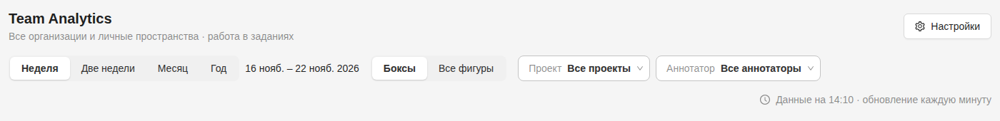
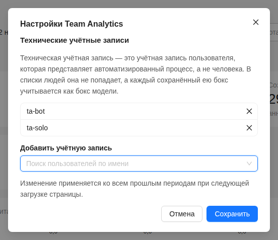

# Настройки Team Analytics

Диалог «Настройки Team Analytics» ([Team Analytics settings](../../../GLOSSARY.md#team-analytics-settings)) хранит список технических учётных записей: учётных записей (account), работу которых Team Analytics не считает работой людей. Откройте его, когда в цифрах страницы среди аннотаторов появилась программа, например учётная запись, которая загружает разметку модели. В том же диалоге администратор включает и выключает [подсказки о горячих клавишах](shortcut-hints.md) для всех пользователей сервера.

## Что изменено относительно CVAT

В CVAT v2.82.0 нет ни страницы Team Analytics, ни её настроек, ни списка технических учётных записей, ни подсказок о горячих клавишах. Форк добавляет диалог «Настройки Team Analytics» на странице [Team Analytics](team-analytics.md).

## Кому доступно

Только администраторам (administrator), то есть участникам группы `admin`. Роль в организации (organization) не даёт доступа, даже роль owner: и чтение, и сохранение списка сервер разрешает только администратору. Остальные пользователи (user) не видят саму страницу Team Analytics, см. [Team Analytics](team-analytics.md).

## Где находится

1. Откройте страницу Team Analytics (`/team-analytics`), см. [ссылки в шапке](grafana-link.md).
2. Нажмите кнопку «Настройки» в шапке (header) страницы, справа от заголовка «Team Analytics».

Кнопка видна, пока страница загружается, показывает цифры или показывает ошибку. Когда доступ отклонён, кнопки нет.

## Как это работает

Диалог называется «Настройки Team Analytics», в нём два раздела: «Технические учётные записи» и, под ним, [«Подсказки о горячих клавишах»](#подсказки-о-горячих-клавишах). Первый раздел — «Технические учётные записи» ([Technical accounts list](../../../GLOSSARY.md#technical-accounts-list)). Под заголовком раздела диалог объясняет, что такое техническая учётная запись ([Technical account](../../../GLOSSARY.md#technical-account)):

> «Техническая учётная запись — это учётная запись пользователя, которая представляет автоматизированный процесс, а не человека. В списки людей она не попадает, а каждый сохранённый ею бокс учитывается как бокс модели.»

Как именно это меняет цифры, описано в [подсчёте цифр Team Analytics](team-analytics-figures.md).

*На снимке тестовые данные: имена учётных записей вымышлены. Снимок сделан до появления раздела «Подсказки о горячих клавишах»: он расположен под списком, над кнопками.*

| Элемент | Что показывает |
| --- | --- |
| Список | Сохранённые учётные записи, по имени пользователя; добавленная в диалоге встаёт в конец и занимает своё место по имени после сохранения. Пустой список: «Технических учётных записей нет.» |
| Крестик у записи (подсказка «Убрать из списка») | Убирает запись из списка в диалоге. |
| «Добавить учётную запись» | Поле поиска с подсказкой «Поиск пользователей по имени». |
| Текст под списком | «Изменение применяется ко всем прошлым периодам при следующей загрузке страницы.» |
| «Сохранить» | Сохраняет на сервере список и переключатель подсказок. |
| «Отмена», крестик «Закрыть» | Закрывают диалог без сохранения. |

### Добавить учётную запись

1. Щёлкните поле «Добавить учётную запись» и начните вводить текст.
2. Через короткую паузу в наборе диалог ищет пользователей. Поиск находит пользователей всего сервера, у которых имя пользователя, имя или фамилия содержит введённый текст, без учёта регистра. Пробелы в начале и в конце текста диалог отбрасывает перед поиском. Без текста поиск показывает первых пользователей сервера.
3. Диалог показывает не больше 20 пользователей, по имени пользователя, в виде `annotator-1 (Имя Фамилия)` или просто `annotator-1`, если имя не указано. Пользователь, который уже в списке, показан серым с пометкой «уже в списке», выбрать его нельзя.
4. Выберите пользователя, например `model-bot`. Он появится в списке диалога.
5. Нажмите «Сохранить».

В поле можно ввести не больше 150 символов: лишние диалог отбрасывает.

### Убрать учётную запись

1. Нажмите крестик справа от записи.
2. Нажмите «Сохранить».

### Сохранить и отменить

«Сохранить» отправляет на сервер весь список целиком и состояние флажка «Показывать подсказки аннотаторам». Сервер заменяет списком прежний список и запоминает флажок. После успешного сохранения диалог закрывается, а страница заново загружает всё, что показывает.

«Отмена», крестик «Закрыть», клавиша Escape и щелчок мимо диалога закрывают его без сохранения: список на сервере остаётся прежним. Пока сохранение идёт, диалог не закрывается и второй раз список не отправляет. Если сервер не ответил за 30 секунд, диалог перестаёт ждать и показывает сообщение о незавершённом сохранении (см. ниже).

### Что меняется в цифрах

Сервер применяет список, когда считает ответ, а не когда записывает итоги. Поэтому изменение действует на все прошлые периоды, а не только на работу после сохранения. Ответы, посчитанные по старому списку, сервер после сохранения больше не отдаёт. Сразу после сохранения страница загружается заново и получает цифры, посчитанные по новому списку. Пока сервер считает их заново, страница может показывать ожидание, см. [Team Analytics](team-analytics.md).

### Один список на весь сервер

Список один для всего сервера, а не для каждой организации. Он действует и в организации, и на уровне всех организаций и личных пространств. Диалог одинаков при любой выбранной организации.

### Ограничения списка

- В списке не больше 1000 учётных записей.
- Добавить можно только существующего пользователя.
- Сервер хранит запись по ID пользователя вместе с последним известным именем.

Список, который сервер не принял, диалог показывает словами сервера после «Сервер не принял список: ». Тексты сервера английские:

| Текст после «Сервер не принял список: » | Причина |
| --- | --- |
| `technical_accounts may name at most 1000 users` | В списке больше 1000 записей. |
| `there is no user <ID>` | Добавлен пользователь, которого нет на сервере. |
| `user <ID> is named twice` | Пользователь указан дважды. |
| `every technical account must be a user id: a positive integer` | В списке не ID пользователя. |
| `technical_accounts must be a list of user ids` | Список отправлен не списком. |

Через диалог обычно встречаются только первые две: диалог сам не даёт выбрать пользователя дважды.

### Удалённая учётная запись

Если пользователя удалили из CVAT, его запись остаётся в списке, пока её не уберут. Диалог показывает её серым курсивом так: «удалённая учётная запись, ID <ID>», например «удалённая учётная запись, ID 77». Такую запись можно убрать крестиком; вернуть её после сохранения нельзя, потому что пользователя больше нет.

### Подсказки о горячих клавишах

Раздел «Подсказки о горячих клавишах» включает и выключает [подсказки о горячих клавишах](shortcut-hints.md) ([shortcut hint](../../../GLOSSARY.md#shortcut-hint)) сразу для всех пользователей сервера. У самих пользователей такого переключателя нет.

Под заголовком раздела диалог объясняет, что такое подсказка:

> «Когда аннотатор в третий раз за час делает мышью то, для чего есть горячая клавиша, в углу холста на несколько секунд появляется подсказка с этой клавишей: не чаще раза в час для одного действия. Когда аннотатор делает действие в основном горячей клавишей (за последний час нажатий клавиши больше половины), подсказка для него не появляется три дня.»

| Элемент | Что показывает |
| --- | --- |
| Флажок «Показывать подсказки аннотаторам» | Отмечен — подсказки показываются; снят — не показываются никому. |
| Текст под флажком | «Изменение действует для каждого пользователя после следующей загрузки страницы CVAT.» |

Чтобы выключить подсказки:

1. Снимите флажок «Показывать подсказки аннотаторам».
2. Нажмите «Сохранить».

Что важно знать:

- Пока настройки ни разу не сохраняли с этим флажком, подсказки включены.
- Переключатель один на весь сервер, как и список: он не зависит от выбранной организации.
- Флажок сохраняется той же кнопкой «Сохранить», что и список технических учётных записей, и тем же запросом. «Отмена» не меняет ни список, ни флажок.
- Пользователь, у которого CVAT уже открыт, увидит изменение после перезагрузки страницы: интерфейс спрашивает сервер один раз за загрузку страницы, когда пользователь впервые открывает задание 2D.
- Число показанных подсказок остаётся на странице Team Analytics и после выключения: считаются подсказки, показанные раньше.
- Раздела нет, если сервер прежней версии не прислал переключатель. Тогда «Сохранить» отправляет только список.

## Состояния и ошибки

| Что вы видите | Причина | Что делать |
| --- | --- | --- |
| «Загрузка…» | Диалог загружает список. | Подождите. «Сохранить» пока недоступна. |
| «Не удалось загрузить настройки.» и кнопка «Повторить» | Сервер не отдал список. | Нажмите «Повторить». |
| «Технических учётных записей нет.» | Список пуст. | Добавьте учётную запись, если нужно. |
| «Поиск…» | Идёт поиск пользователей. | Подождите. |
| «Пользователи не найдены» | Никто не подходит под введённый текст. | Измените текст. |
| «Не удалось выполнить поиск.» | Поиск не удался. | Введите текст ещё раз. |
| «Сервер не принял список: …» или «Список отклонён.» | Сервер отклонил список (HTTP 400), причины выше. | Исправьте список и сохраните снова. |
| «Сеанс завершён. Войдите снова, чтобы сохранить.» | Сеанс (sign-in session) закончился (HTTP 401). | Войдите снова и повторите. |
| «Настройки Team Analytics могут менять только администраторы.» | Вы больше не администратор (HTTP 403). | Обратитесь к администратору сервера. |
| «Сохранение не завершилось, поэтому список мог не измениться. Откройте настройки снова, чтобы увидеть сохранённый список.» | Сервер не ответил, ответил ошибкой или не ответил за 30 секунд. Список мог сохраниться: например, при HTTP 503 сервер список сохранил, но ещё может отдавать цифры, посчитанные по старому списку. | Закройте диалог, откройте снова и проверьте список. При необходимости сохраните ещё раз: повторное успешное сохранение убирает и старые цифры. |

Если сервер отказал в доступе к списку или к поиску, пока диалог открыт, диалог закрывается и страница показывает отказ в доступе, см. [Team Analytics](team-analytics.md).

## Настройки

Список не задаётся настройками (setting) сервера. Прежняя переменная окружения (environment variable) `TEAM_ANALYTICS_TECHNICAL_ACCOUNTS` игнорируется, см. [настройки сервера](server-settings.md).

## См. также

- [Team Analytics](team-analytics.md)
- [Подсчёт цифр Team Analytics](team-analytics-figures.md)
- [HTTP API Team Analytics](../reference/team-analytics-api.md)
- [Подсказки о горячих клавишах](shortcut-hints.md)
- [Настройки сервера](server-settings.md)
- [Operating Team Analytics: technical accounts list](../../team-analytics.md#technical-accounts-list) — список со стороны сервера (для DevOps, на английском)
