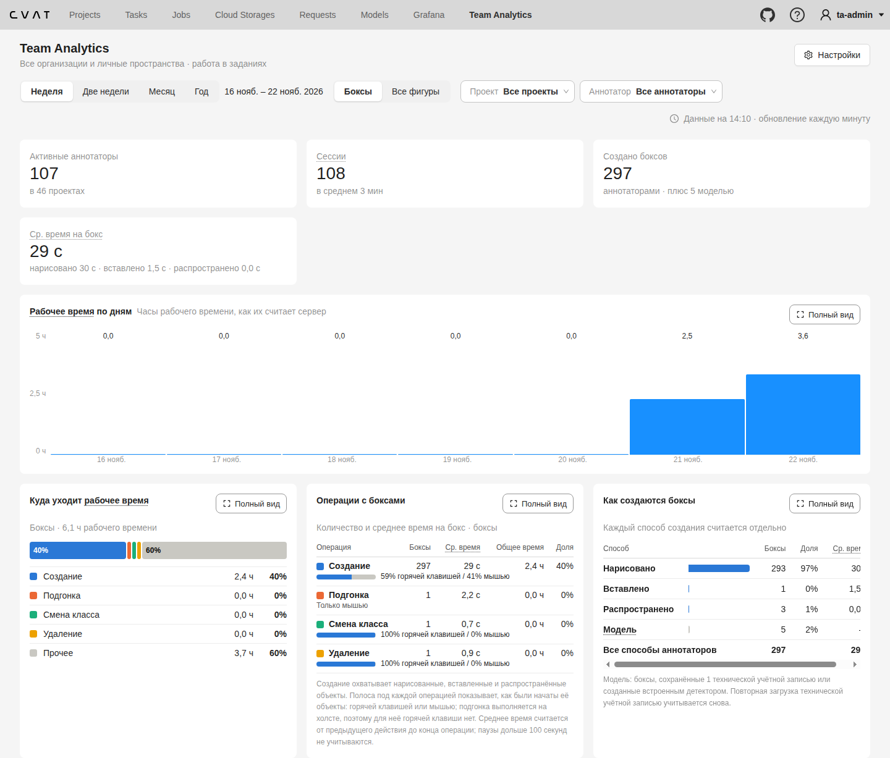
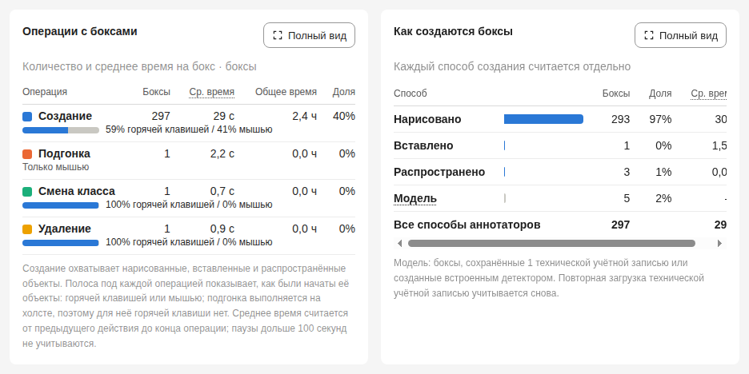
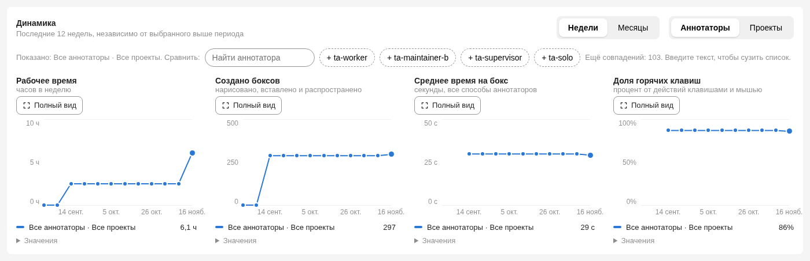

# Страница Team Analytics

Страница [Team Analytics](../../../GLOSSARY.md) показывает, как команда аннотаторов работает в заданиях (job): рабочее время, сессии, операции с объектами, клавиатуру и мышь, динамику за 12 недель или месяцев. Откройте её, когда нужно увидеть загрузку людей и проектов за неделю, месяц или год.

*На снимках этой страницы тестовые данные: имена учётных записей и проектов вымышлены.*

## Что изменено относительно CVAT

В CVAT v2.82.0 такой страницы нет: в шапке (header) есть только ссылка на Grafana. Форк добавляет страницу `/team-analytics` с её API и настройками. Страница только на русском языке. Ссылки в шапке описаны на странице [Ссылки «Grafana» и «Team Analytics»](grafana-link.md).

## Кому доступно

| Кто | Что видит |
| --- | --- |
| Администратор (administrator, член группы `admin`), аналитика на сервере включена | Ссылку «Team Analytics» в шапке и всю страницу. |
| Любой другой пользователь (user) | Ссылки нет. Адрес, набранный вручную, показывает «Страница Team Analytics недоступна». Сервер отвечает таким пользователям отказом на каждый запрос. |
| Кто угодно, если аналитика на сервере выключена | Ссылки нет. Адрес, набранный вручную, показывает ту же панель «Страница Team Analytics недоступна». |

Роль в организации (organization) значения не имеет: решает только группа `admin`.

## Где находится

Ссылка «Team Analytics» в шапке CVAT или адрес `https://cvat.example.com/team-analytics`.

Строка запроса адреса хранит выбор на странице, поэтому вид можно сохранить в закладки или переслать другому администратору:

| Параметр | Значение |
| --- | --- |
| `period` | `week`, `two_weeks`, `month`, `year`; без него — `week`. |
| `month` | Месяц `2026-10` при `period=month`; без него или для будущего месяца — текущий месяц. |
| `project`, `annotator` | Выбранные проект (project) и аннотатор (`0` — «Без проекта»). |
| `org` | Организация, в которой выбраны фильтры. Если сейчас выбрана другая организация, фильтры ссылки не применяются. |
| `shapes` | `all` для «Все фигуры»; без него — «Боксы». |
| `view`, `rows` | Открытый полный вид и его строки (`rows=projects`). |

Каждое изменение выбора — новая запись в истории браузера: кнопки «Назад» и «Вперёд» браузера возвращают прежний вид. Неверное значение в адресе заменяется значением по умолчанию.

Пример: `https://cvat.example.com/team-analytics?period=month&month=2026-10&project=12&org=visionteam`.

## Как это работает

Страница сначала проверяет группы вошедшего пользователя. Не администратору она сразу показывает панель «недоступна» и ничего не запрашивает. Как считается каждый показатель, описано на странице [Как считаются показатели Team Analytics](team-analytics-figures.md); здесь — только как пользоваться экраном.

У некоторых заголовков и столбцов («Сессии», «Рабочее время», «Ср. время», «Модель») слово подчёркнуто пунктиром: при наведении или фокусе с клавиатуры всплывает подсказка (tooltip) с определением.

### Заголовок и область данных

Вверху — «Team Analytics» и под ним область данных:

- организация выбрана в CVAT — «Организация visionteam · работа в заданиях»: организация ([organization scope](../../../GLOSSARY.md)), только её работа;
- организация не выбрана — «Все организации и личные пространства · работа в заданиях»: все организации и все личные пространства (personal workspace) сервера вместе.

Смените организацию в меню CVAT, чтобы сменить область. Показатели другой организации на экране не остаются: страница загружается заново.

Справа кнопка «Настройки» открывает «Настройки Team Analytics» — список технических учётных записей; см. [Настройки Team Analytics](team-analytics-settings.md). После сохранения списка страница загружает все данные заново.

### Период

Четыре кнопки периода ([period](../../../GLOSSARY.md)):

| Кнопка | Что охватывает | Как карточки называют период |
| --- | --- | --- |
| «Неделя» | Последние 7 дней по сегодня (по умолчанию). | «За 7 дней» |
| «Две недели» | Последние 14 дней. | «За 14 дней» |
| «Месяц» | Календарный месяц, сначала текущий. | Название месяца; для текущего с « · по сегодня» |
| «Год» | Последние 12 месяцев, по неделям. | «За 12 месяцев» |

Дни считаются в часовом поясе вашего браузера, например `Europe/Moscow`. Рядом с кнопками показан диапазон дат. Для «Месяц» появляются стрелки «Предыдущий месяц» и «Следующий месяц»; позже текущего месяца перейти нельзя. Своего диапазона дат нет.

Кнопка периода или стрелка недоступна, пока этот период обработан не полностью: при наведении на неё написано «Ещё не обработано». Сначала обрабатываются последние дни, поэтому «Неделя» становится доступна первой, а «Две недели», «Год» и ранние месяцы — позже.

### Переключатель «Боксы» / «Все фигуры»

«Боксы» (по умолчанию) считает операции только с боксами (bounding box); «Все фигуры» — с фигурами (shape) любого типа. Переключатель меняет все показатели операций и способов создания, и их названия: «Создано боксов» / «Создано объектов», «Операции с боксами» / «Операции с объектами», «Как создаются боксы» / «Как создаются объекты». Рабочее время, сессии и число аннотаторов от него не зависят.

Для периода до перехода ([legacy period](../../../GLOSSARY.md)) переключателя нет: там есть только все фигуры.

### Фильтры по проекту и аннотатору

Два выпадающих списка: «Проект» («Все проекты») и «Аннотатор» («Все аннотаторы»). Каждый предлагает проекты или аннотаторов ([annotator](../../../GLOSSARY.md)), у которых была работа в заданиях за показанный период, и поле поиска «Поиск проектов» или «Поиск аннотаторов». Пока список грузится, в нём «Загрузка…»; для необработанного периода — «Этот период ещё не обработан»; при сбое — «Не удалось загрузить список»; без совпадений — «По этому запросу ничего не найдено».

Выбранный фильтр применяется ко всей странице. Кнопка «×» рядом со списком («Показать все проекты», «Показать всех аннотаторов») снимает его. Фильтр можно задать и щелчком по строке карточек «Рабочее время по аннотаторам», «Рабочее время по проектам» или таблицы «Подробности»; повторный щелчок по выбранной строке снимает фильтр.

Задачи (task) вне проектов собраны в строку «Без проекта» ([No project](../../../GLOSSARY.md)). Проект без названия, например удалённый, показан как «Проект #12». Аннотатор без имени — «Аннотатор #…».

Список проектов не зависит от выбранного аннотатора, и наоборот.

### Свежесть данных

В строке фильтров — «Данные на 17:40 · обновление каждые 10 мин» (время в вашем часовом поясе; для другого дня — с датой; частоту обновления задаёт сервер, 10 минут — значение по умолчанию). Пока данные не обновлялись ни разу — «Ещё не обновлялось». Страница перечитывает это время раз в минуту.

Если последнее обновление слишком старое, под строкой фильтров появляется предупреждение «Последнее обновление показателей: …, более 30 минут назад. Недавняя работа может быть не учтена.» Порог — 30 минут. Если обновлений не было — «Показатели ещё не обновлялись. Недавняя работа может быть не учтена.»

### Обработка истории

Пока обработанная история ([processed history](../../../GLOSSARY.md)) неполна, над карточками показана полоса «Обработка истории»: «Готово с …», сколько дней из скольких и процент. Под ней: «Сначала обрабатываются последние дни. Периоды «Две недели» и «Год» и более ранние месяцы становятся доступны по мере обработки; страница никогда не показывает период, обработанный лишь частично.»

Если открыть необработанный период по ссылке, вместо карточек показано «Этот период ещё не обработан» и совет выбрать более короткий период. Когда обработка периода закончится, страница сама загрузит его показатели.

### Уведомления о периоде до перехода

- «Этот период записан до перехода на новый учёт действий» — весь период до перехода на новый учёт действий ([cutover](../../../GLOSSARY.md)): операции относятся ко всем фигурам, смены класса и горячие клавиши не записывались.
- «Новый учёт действий начался 2 ноября 2026» (дата перехода) — период, частично записанный до перехода ([partly legacy period](../../../GLOSSARY.md)): показатели по боксам, смены класса и горячие клавиши охватывают только дни после даты; в режиме «Все фигуры» операции до неё тоже учтены.

Период без работы в заданиях не показывает ни одного из этих уведомлений. Что именно не учтено, описано в [Как считаются показатели](team-analytics-figures.md).

### Карточки обзора

Обзор ([overview](../../../GLOSSARY.md)) — карточки (card) в порядке экрана:

| Карточка | Что показывает | Подсказка при наведении | Пусто |
| --- | --- | --- | --- |
| «Активные аннотаторы» | Число аннотаторов и «в N проектах»; с выбранным аннотатором — «N из M»; с выбранным проектом — «работали в выбранном проекте». | — | `0` |
| «Сессии» | Число сессий ([session](../../../GLOSSARY.md)) и «в среднем …». | На числе: «Непрерывные интервалы работы · … всего». | «в этом периоде сессий нет» |
| «Создано боксов» / «Создано объектов» | Объекты, созданные аннотаторами, и под числом «аннотаторами · плюс N моделью»: объекты «Модели» ([Model](../../../GLOSSARY.md)) показаны рядом, в число не входят; `0` тоже показан. | «Точное значение: …» | `0` |
| «Ср. время на бокс» / «Ср. время на объект» | Среднее время на операцию ([time per operation](../../../GLOSSARY.md)) создания и под ним среднее по способам: «нарисовано … · вставлено … · распространено …». | — | «—» |
| «Рабочее время по дням» (для «Год» — «по неделям») | Столбцы часов рабочего времени ([working time](../../../GLOSSARY.md)) по дням или неделям. | На столбце: день и точные часы. | Нулевые столбцы |
| «Куда уходит рабочее время» | Полоса и легенда: «Создание», «Подгонка», «Смена класса», «Удаление», «Прочее» — часы и доля. | На части полосы: операция, часы, доля. | «В этом периоде нет работы в заданиях» |
| «Операции с боксами» / «Операции с объектами» | Таблица: «Операция», «Боксы»/«Объекты», «Ср. время», «Общее время», «Доля»; под каждой операцией — доля начатых горячей клавишей и мышью («Только мышью», «Не записано»). | На строке способа начала: проценты; на общем времени — точные часы. | «Не записано» для незаписанной операции |
| «Как создаются боксы» / «Как создаются объекты» | Способы «Нарисовано», «Вставлено», «Распространено», строка «Модель» (без времени) и «Все способы аннотаторов». В периоде до перехода — число сохранённых однокадровых боксов. | На числе: способ, число, доля. | Нули |
| «Рабочее время по проектам» | До восьми проектов с наибольшим временем, полоса каждого разделена по операциям; остальные — строкой «Ещё N проектов не показано». | На строке: точные часы; на части полосы — операция. | «В этом периоде нет работы в заданиях» |
| «Рабочее время по аннотаторам» | То же по аннотаторам. | То же. | То же. |
| «Клавиатура и мышь» | «Действия горячими клавишами», «Действия мышью», «Доля горячих клавиш», «Самые частые горячие клавиши» с клавишами, которые назначены этим действиям сейчас в ваших настройках горячих клавиш CVAT. Названия действий — английские, как в этих настройках, например «Next frame». | «Точное значение: …»; на полосе доли — «N действий горячими клавишами из M». | «В этом периоде нет действий горячими клавишами»; в периоде до перехода, где не посчитано ни одного действия, — «Использование горячих клавиш в этом периоде не записывалось» |
| «Динамика» | См. ниже. | | |
| «Подробности» | См. ниже. | | |

Карточка «Рабочее время по проектам» показана, только если сервер её прислал. Карточка «Клавиатура и мышь» в периоде до перехода показывает текст «не записывалось», только если в нём не посчитано ни одного действия клавишами или мышью; иначе она показывает посчитанное.

### Полный вид

Кнопка «Полный вид» в заголовке карточки или кнопка «Показать все N в полном виде» под сокращённым списком открывает полный вид ([full view](../../../GLOSSARY.md)): одна карточка вместо обзора, со всеми строками. Кнопка «Назад к обзору» возвращает обзор; кнопка «Назад» браузера — тоже.

Полный вид добавляет:

- все строки вместо сокращённого списка, поиск («Найти проект», «Найти аннотатора», «Найти действие или клавишу») и сортировку «По значению» / «По имени»;
- для «Куда уходит рабочее время», операций и способов создания — переключатель «Строки»: «Аннотаторы» / «Проекты», с таблицей по каждой строке;
- для рабочего времени по дням — крупный график и список «Все значения»;
- для «Клавиатура и мышь» — «Использование горячих клавиш»: каждое действие, его клавиша и число;
- для графика динамики — один крупный график и открытую таблицу значений.

Под заголовком полного вида — период, что показано и текущие фильтры («Все аннотаторы · Все проекты»). Щелчок по строке рабочего времени ставит фильтр, как на обзоре.

### Динамика и сравнение

Карточка «Динамика» ([trends](../../../GLOSSARY.md)) показывает четыре графика за последние 12 недель или 12 месяцев, независимо от выбранного выше периода:

| График | Единица |
| --- | --- |
| «Рабочее время» | часов в неделю или в месяц |
| «Создано боксов» / «Создано объектов» | нарисовано, вставлено и распространено |
| «Среднее время на бокс» / «Среднее время на объект» | секунды, все способы аннотаторов |
| «Доля горячих клавиш» | процент от действий клавишами и мышью |

Переключатель «Недели» / «Месяцы» меняет шаг. Переключатель «Сравнение»: «Аннотаторы» / «Проекты». Без сравнения график показывает одну линию — текущую область и фильтры («Показано: Все аннотаторы · Все проекты. Сравнить:»). Добавьте в сравнение ([comparison](../../../GLOSSARY.md)) до пяти аннотаторов или проектов кнопками «+ имя» или через поиск; каждый получает свой цвет, «×» убирает его. На пределе написано «Одновременно — не более 5. Чтобы добавить аннотатора, уберите одного из выбранных.» (для проектов — «Чтобы добавить проект, уберите один из выбранных»). Под каждым графиком свёрнута таблица «Значения». Недели или месяцы до перехода показаны как «До нового учёта действий не записывалось», необработанные — «Ещё не обработано».

Карточка появляется, когда обработаны хотя бы три полные недели; до этого на её месте — «Динамика появится по мере обработки истории» и, например, «Для динамики нужно не менее трёх полных недель. Пока готова одна.»

### Подробности

Таблица «Подробности» в конце обзора; полного вида у неё нет. Переключатель строк «Аннотаторы» / «Проекты».

Столбцы: «Аннотатор» или «Проект», «Проекты» или «Аннотаторы», «Сессии», «Рабочее время», «Нарисовано», «Вставлено», «Распространено», «Модель» (в периоде до перехода — «Сохранённые боксы»), «Подгонки», «Смены класса», «Удаления», «Ср. время создания», «Доля горячих клавиш».

- Сортировка одна: «Отсортировано по рабочему времени».
- Поиск «Найти аннотатора» или «Найти проект» ищет по имени, как его показывает страница.
- По 10 строк на странице, «1–10 из N», кнопки «Назад» и «Вперёд».
- Таблицу сужает только фильтр по другому измерению; выбранная строка своего измерения лишь подсвечена.
- Если есть технические учётные записи, рядом написано «N технические учётные записи не входят в списки аннотаторов».

### Ширина окна

Страница рассчитана на широкое окно. Таблица «Подробности» не уже 1180 пикселей, таблицы полного вида — 720 или 1040 пикселей; в узком окне они прокручиваются вбок. Таблица карточки «Как создаются боксы» прокручивается вбок уже в окне шириной 1440 пикселей: её последний столбец «Ср. время» виден не целиком.

## Состояния и ошибки

| Что вы видите | Причина | Что делать |
| --- | --- | --- |
| Индикатор загрузки на месте карточек | Страница или первые показатели загружаются. Пока сервер готовит ответ, он просит подождать, и страница повторяет запрос сама. | Подождите. |
| Прежние показатели приглушены | Загружаются показатели нового выбора. | Подождите. |
| «Страница Team Analytics недоступна» и ссылка «Назад к задачам» | Вы не администратор, аналитика на сервере выключена, выбранная организация серверу неизвестна, или сервер отказал в доступе во время работы. | Обратитесь к администратору сервера. |
| «Сеанс завершён» — «Войдите снова, чтобы увидеть Team Analytics.» | Сеанс входа закончился. | Войдите снова. |
| «Не удалось загрузить Team Analytics» — «Сервис аналитики не ответил. Остальные разделы CVAT не затронуты. Повторите попытку позже.» | Сервер не ответил, ответ не готов после повторов, или страница не загрузилась. | Обновите страницу позже. Остальной CVAT работает. |
| «Этот период ещё не обработан» | Обработана не вся история периода. | Выберите более короткий период или подождите. |
| Кнопка периода недоступна, «Ещё не обработано» | То же. | Подождите. |
| «Динамика появится по мере обработки истории» | Обработано меньше трёх полных недель. | Подождите. |
| «Загрузка динамики…», «Не удалось загрузить динамику. Запрос повторится при смене фильтров.» | Динамика загружается или не загрузилась. | Смените фильтр или обновите страницу. |
| «Не удалось обновить динамику; на графиках данные для прежнего выбора.» | Новый запрос не удался, показан прежний. | То же. |
| «Не удалось загрузить список. Запрос повторится при изменении выбора.» | Строки полного вида не загрузились. | Смените выбор или обновите страницу. |
| «Не удалось обновить список; показаны данные для прежнего выбора.» | Новый запрос полного вида не удался. | То же. |
| «Не удалось загрузить подробности.», «Не удалось обновить подробности; в таблице данные для прежнего выбора.» | Таблица не загрузилась. | То же. |
| «В этом периоде нет работы в заданиях» | В области и фильтрах нет работы за период. | Смените период, область или фильтр. |
| «По этому запросу ничего не найдено» | Поиск ничего не нашёл. | Измените текст поиска. |
| «Не записано», «—» | Показатель не записывался в этом периоде или его нечем считать. | См. [Как считаются показатели](team-analytics-figures.md). |

Сбой Team Analytics не затрагивает разметку и другие разделы CVAT.

## Настройки

Включение аналитики, частоту обновления показателей и ожидание ответа задаёт администратор сервера: см. [Настройки сервера](server-settings.md). Список технических учётных записей — на странице [Настройки Team Analytics](team-analytics-settings.md).

## См. также

- [Как считаются показатели Team Analytics](team-analytics-figures.md)
- [Настройки Team Analytics](team-analytics-settings.md)
- [Ссылки «Grafana» и «Team Analytics»](grafana-link.md)
- [HTTP API Team Analytics](../reference/team-analytics-api.md)
- [Настройки сервера](server-settings.md)
